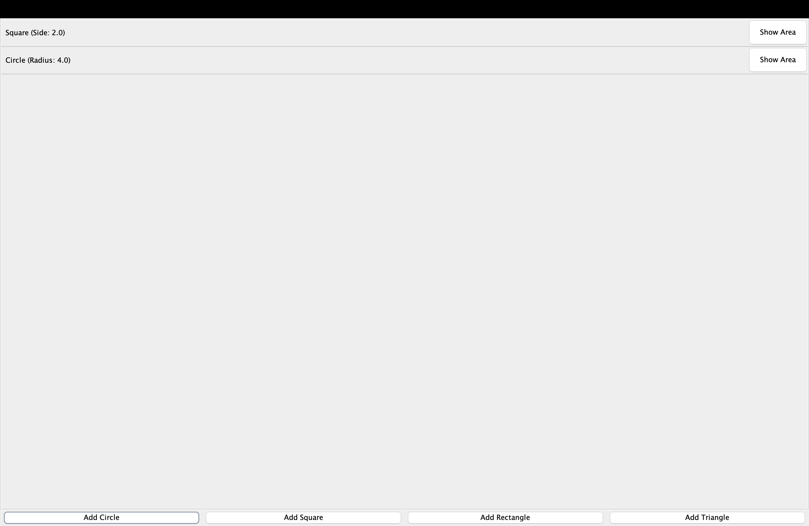
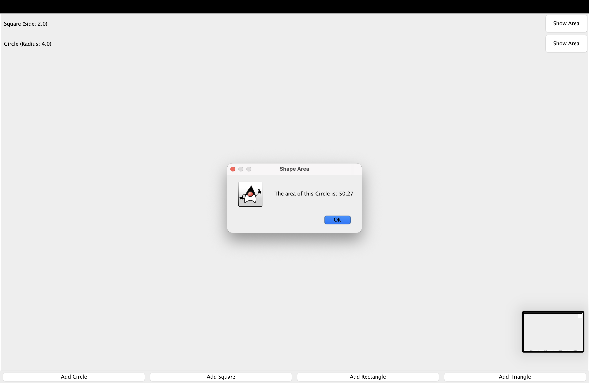
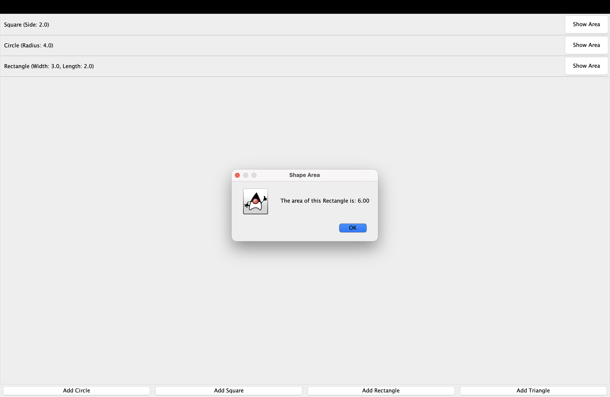
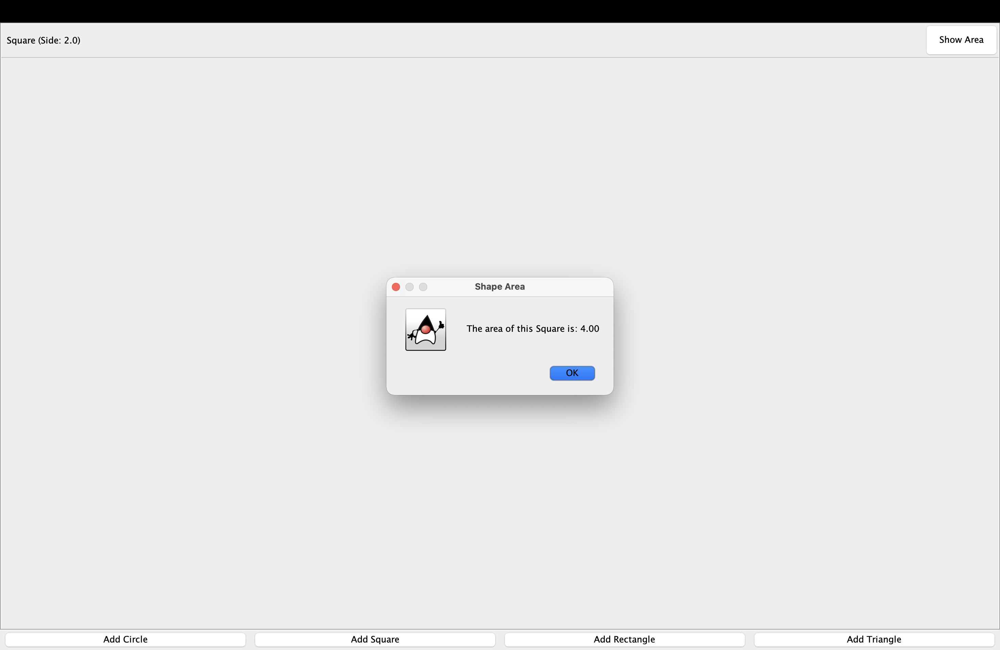
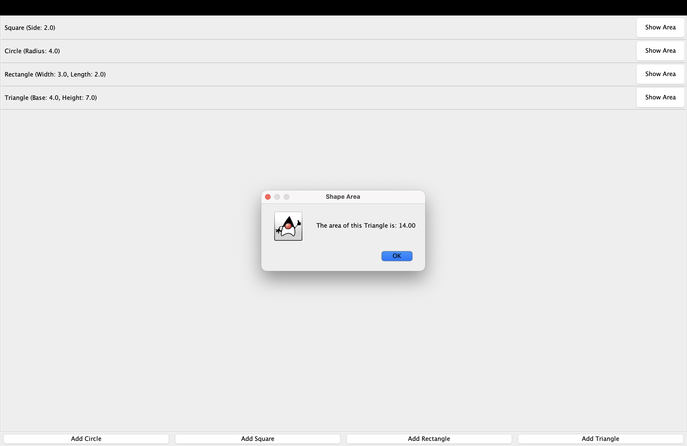

# OOP_Assign_02: Shape Manager

## Collaborators:
- Pujan Mijar

## Installation
```bash
chmod +x run.sh
./run.sh
```

## Screenshots

### Circle and Square


### Entering a Circle's Radius


### Rectangle Created


### Square Created


### All Shapes Created



